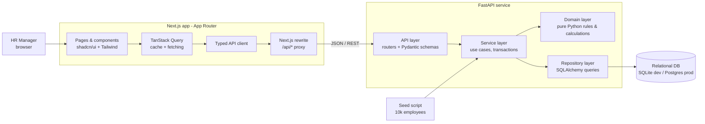
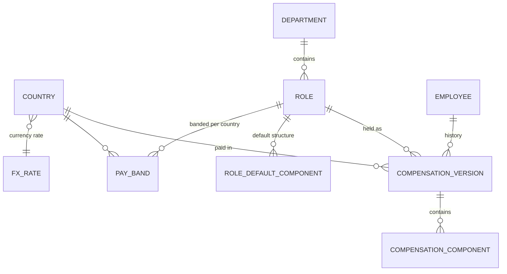

# Architecture & Design Notes

Companion to [REQUIREMENTS.md](REQUIREMENTS.md) and [COMPENSATION_MODEL.md](COMPENSATION_MODEL.md). This doc explains **how** the system is built and **why** each choice was made.

## 1. System overview



A single deployable backend and a single Next.js frontend. The browser only talks to the Next.js origin; Next.js forwards `/api/*` to FastAPI. This keeps everything same-origin, so there are no CORS headaches and cookies stay first-party. There are no microservices, queues, or caches: at 10k employees a well-indexed relational database answers everything in milliseconds, and extra infrastructure would only add failure modes.

## 2. Tech stack

| Area | Choice | Why |
|---|---|---|
| API | **FastAPI** (Python 3.12) | Typed, async-capable, auto OpenAPI docs, matches the role. |
| Validation / schemas | **Pydantic v2** | Request/response contracts; generates the OpenAPI spec the UI is typed from. |
| ORM | **SQLAlchemy 2.0** (typed) | Mature; works with both SQLite and Postgres. |
| Migrations | **Alembic** | Versioned schema, reproducible deploys. |
| Database | **SQLite** locally & in tests, **Postgres** in production | SQLite needs no setup and makes tests fast; Postgres for a real deployment. Only portable SQL is used (see §6). |
| Backend tests | **pytest**, httpx `TestClient`, coverage | Standard, fast, readable. |
| Lint / types | **ruff**, **mypy** | Keeps style consistent and catches errors before they reach review. |
| Frontend | **Next.js 15 (App Router) + React + TypeScript** | File-based routing, layouts, middleware for route protection, and built-in API proxying (rewrites). Deploys natively on Vercel. |
| Components | **shadcn/ui** (Radix primitives + Tailwind CSS) | Components are copied into the repo, so we own and can style them; accessible via Radix; a clean, modern look without fighting a heavy theme system. |
| Data table | **TanStack Table** (shadcn `DataTable` pattern) in server-side mode | Paging, sorting, and filtering are driven by API query params, never 10k rows in the browser. |
| Server state | **TanStack Query** | Caching, loading/error states, and invalidation after edits. No hand-rolled global store. |
| Forms | **React Hook Form + Zod** (shadcn `Form`) | Client-side validation that mirrors server rules, for fast feedback. |
| Charts | **Recharts** via **shadcn Charts** | shadcn's chart components are built on Recharts, so charts share the same theme tokens as the rest of the UI. |
| Frontend tests | **Vitest + React Testing Library** | Fast, behaviour-focused component tests. |
| Deploy | **Render** (API + managed Postgres), **Vercel** (Next.js) | Free tiers, Git-based deploys, no ops work. |

## 3. Backend layering

```
backend/app/
├── api/            # FastAPI routers. HTTP only: parse, call a service, map errors → status codes
├── schemas/        # Pydantic request/response models (the API contract)
├── services/       # Use cases: create employee, revise compensation, compute insights
├── domain/         # PURE Python: Money, components, package calculations, validation rules
├── repositories/   # SQLAlchemy queries; the only layer that knows SQL
├── models/         # SQLAlchemy ORM tables
├── core/           # config, DB session, clock, error types
└── seed/           # deterministic data generator
```

**Dependency rule:** `api → services → (domain, repositories)`. **`domain` imports nothing** from the framework, ORM, or database.

**Why:** all the interesting logic (total-comp calculation, FTE normalisation, compa-ratio, overlap rules, the 25 edge cases) lives in `domain/` as plain functions and dataclasses. It can be unit-tested in microseconds without a database, which makes TDD practical. Routers stay thin and boring.

**Injected clock:** "current package" depends on today's date (future-dated raises, E14). Services take a `Clock` dependency and endpoints accept an optional `as_of` date. Tests pin the date, so time-dependent behaviour is deterministic.

## 4. Data model



| Table | Key columns | Notes |
|---|---|---|
| `country` | `code` (ISO-3166), `name`, `currency` (ISO-4217) | One currency per country. |
| `fx_rate` | `currency`, `usd_per_unit` (decimal), `rate_set`, `is_active` | Fixed, versioned reference rates. Exactly one rate set is active, and all USD figures use it. |
| `department` | `id`, `name` | |
| `role` | `id`, `department_id`, `family`, `level` (1–5), `title` | e.g. Software Engineer, L3. |
| `role_default_component` | `role_id`, `type` (bonus or commission), `percent`, `label` | Template copied onto new hires (E3, E4). A percentage of base, because a role spans every currency. |
| `pay_band` | `role_id`, `country_code`, `min/mid/max_minor` | Unique per (role, country). |
| `employee` | `id`, `employee_code` (unique), `name`, `email` (unique), `employment_type`, `fte`, `status`, `hire_date`, `termination_date` | No role or country: those belong to the version in force (see below). |
| `compensation_version` | `id`, `employee_id`, `effective_from`, `effective_to` (nullable), `reason`, `role_id`, `country_code`, `currency`, `base_annual_minor`, **derived (local currency only):** `fixed_cash_minor`, `target_variable_minor`, `ttc_minor`, `note`, `created_at` | Immutable once written, except `effective_to`, set when a later version supersedes it. |
| `compensation_component` | `version_id`, `type`, `basis`, `value`, `frequency`, `payout_date` | |

### Design decisions
- **Versions are immutable; a change appends a new row.** A revision closes the previous version (`effective_to = new.effective_from`) and inserts the new one in **one transaction**. The service checks for overlaps (E16) and a partial unique index backs it up ("one open version per employee").
- **Only values that depend on the version alone are stored on it.** Fixed cash, target variable, and TTC in **local currency** depend only on the version's own base and components. Since a version never changes, the domain layer computes them **once at write time**. This deliberate denormalisation means insight queries never have to unpack 10k component lists.
- **Values that depend on external, changeable data are computed at read time:**
  - **USD amounts** = `ttc_minor × usd_per_unit` of the *active* rate set (a join on `fx_rate`). If USD were stored per version, a rate update would leave old versions on old rates, and org-wide totals would silently mix exchange rates.
  - **Compa-ratio and band position** = FTE-equivalent base vs. the *current* `pay_band` (a join on role + country). Bands are revised (typically yearly). A stored compa-ratio would go stale, and with it every "below band" flag and the Exceptions view.

  Both are indexed joins over ~10k current versions, well within the latency budget. The calculation logic still lives in the domain layer; repositories supply the inputs.
- **Money is stored as integers** (`*_minor` = cents/paise), with the currency on the row. A `Money` value object in the domain prevents adding different currencies.
- **"Current" version** = `effective_from <= as_of AND (effective_to IS NULL OR effective_to > as_of)`.
- **Role and country live on the version, not the employee.** An employee's role, country, band and currency are those of the version in force on `as_of` (or, before their start date, of their first version). A promotion or transfer dated 1 Jan 2027 therefore applies on that day with no scheduled job, the same read-time rule as USD and compa-ratio. An employee with no version at all (E13) has no role or country until a package is recorded.
- **Decimals are stored exactly.** FX rates, FTE and percentages use an `ExactDecimal` column type: `NUMERIC` on Postgres, text on SQLite (which would otherwise round them through floating point).

### Indexes
`employee(status)`, `employee(name)`, `employee(employment_type)`, unique `employee(employee_code)`, unique `employee(email)`, `compensation_version(employee_id, effective_from)`, `compensation_version(role_id)`, `compensation_version(country_code)`, partial unique `compensation_version(employee_id) WHERE effective_to IS NULL` (one open version per employee), unique `pay_band(role_id, country_code)`, `fx_rate(is_active, currency)`.

## 5. API design

REST, JSON, `/api/v1` prefix; OpenAPI docs at `/docs`.

| Method & path | Purpose |
|---|---|
| `GET /employees` | Paginated list. `page`, `page_size` (≤ 100), `sort` (`name`, `employee_code`, `base`, `total_pay_usd`, `compa_ratio`, `last_change`), `order`, `q` (name/code prefix), filters: `country`, `department`, `role`, `level`, `employment_type`, `status` (default: active and on leave), `band_position`, `as_of`. Returns `{items, total, page, page_size}`. |
| `GET /employees/export.csv` | CSV of the same filtered list, all pages (S4). Amounts in major units; formula-like text neutralised. |
| `GET /employees/{id}` | Profile: current package with components, totals in local currency and USD, variable share, band comparison with the band range, peers in role and country (count, median FTE-equivalent base), pending changes, one-time payments. Accepts `as_of`. |
| `POST /employees` | Hire: creates the employee + first version (role defaults unless `components` are given). Returns the profile, `201` + `Location`. |
| `PATCH /employees/{id}` | Update non-compensation details (name, email, employment type, FTE, active / on leave). |
| `POST /employees/{id}/terminate` | Ends employment: records the last day worked (which may be in the future; status is derived from it at read time) and keeps the record and salary history. There is deliberately no `DELETE`: salary history is a record HR must keep. |
| `GET /employees/{id}/compensation` | Full version history, newest first, each with its state (`current`, `pending`, `past`, `superseded`) and raise % in local currency. |
| `POST /employees/{id}/compensation` | New version (raise, promotion, transfer, correction) with `effective_from` + `reason`. Returns the new history entry, `201`. |
| `POST /employees/{id}/compensation/preview` | Dry run of the above: before → after, band position against the new role's band, raise %, USD, whether it takes effect later. Runs the same checks as a save; writes nothing (decision Q2). |
| `GET /insights/summary` | Headcount, joiners and leavers this quarter, total and median pay (USD), % paid within band, bonus-eligibility rate, variable share, employees without a package. |
| `GET /insights/breakdown` | `group_by=country\|department\|level` (contractors grouped separately), optional `country` / `department` / `level` filters → headcount, min/median/mean/max in USD, variable share. |
| `GET /insights/band-distribution` | Below / in / above band counts and % in band, by group. Contractors left out. |
| `GET /insights/exceptions` | Counts for below band, above band, changes due in the next 60 days and missing packages (the sidebar badge is their total), plus a page of one `type`, largest gap first. |
| `GET /insights/recent-changes` | The latest recorded changes (not hires), newest first, with raise % and whether pending. `limit` (default 5). |
| `GET /reference/{countries,departments,roles,pay-bands}` | Dropdown data; roles include their default components. |
| `POST /auth/login` · `POST /auth/logout` · `GET /auth/me` | Session management (see §5a). Every other endpoint except `GET /health` requires a session. |

Money is returned as `{"amount_minor": 240000000, "currency": "INR"}`. Decimals (FTE, percentages, compa-ratio) are fixed-precision strings such as `"0.89"`, so clients never parse floats and SQLite and Postgres return the same text.

**Errors** use one consistent shape, `{ "error": { "code": "OVERLAPPING_VERSION", "message": "...", "details": {...} } }`. Domain exceptions map to 409 (a clash with stored data: overlapping versions, duplicates) or 422 (a broken rule) in a single handler, so routers have no try/except clutter. A missing, expired, or tampered session returns **401** (`UNAUTHENTICATED`), and the UI responds by redirecting to `/login`.

**Pagination:** offset/limit. At 10k rows offset cost is negligible, and keyset pagination would complicate arbitrary sorting for no benefit.

## 5a. Authentication (env-based single login)

```mermaid
sequenceDiagram
    participant B as Browser
    participant N as Next.js (middleware + /api proxy)
    participant A as FastAPI
    B->>N: GET /employees (no cookie)
    N-->>B: 307 redirect → /login
    B->>N: POST /api/auth/login {email, password}
    N->>A: forward
    A->>A: compare email; bcrypt.verify(password, HR_ADMIN_PASSWORD_HASH)
    A-->>B: 200 + Set-Cookie: session=<signed JWT>; HttpOnly; Secure; SameSite=Lax
    B->>N: GET /api/employees (cookie)
    N->>A: forward with cookie
    A->>A: verify JWT signature + expiry
    A-->>B: 200 data
```

| Aspect | Decision |
|---|---|
| Credentials | `HR_ADMIN_EMAIL` and `HR_ADMIN_PASSWORD_HASH` (bcrypt) as backend env vars. No users table. The plain password is never stored, and a helper script generates the hash. |
| Session | Signed JWT (`SESSION_SECRET`, HS256, 8-hour expiry) in an **HttpOnly, Secure, SameSite=Lax** cookie. JavaScript can't read it, which limits XSS impact. |
| Enforcement | **FastAPI is the real gate:** a single `require_session` dependency on every router except `/auth/login` and `/health` (the hosting platform's health check can't send a cookie, and health exposes no salary data). Next.js `middleware.ts` only checks that the cookie exists and redirects to `/login`, for UX. |
| Same-origin | Because Next.js proxies `/api/*`, the cookie is first-party, with no cross-site cookie or CORS configuration. |
| Failure handling | Generic "invalid email or password" message (no account enumeration); constant-time comparison. |
| Not included (yet) | Rate limiting / lockout, password reset, multiple users, roles. Noted as next steps. |

Tests cover the happy path, wrong password, missing or expired or tampered cookie → 401, and a single test walks the route table (from the OpenAPI schema) and sends every route except login and health a request without a session, expecting 401. The app refuses to start without a complete login configuration.

## 6. Performance at 10k employees

| Concern | Approach |
|---|---|
| Listing 10k rows | Never sent to the browser. Server-side paging, sorting, and filtering; max page size 100. |
| Search | Indexed `LIKE 'prefix%'` on name and code. Postgres `pg_trgm` is a later option if fuzzy search is needed. |
| Insight aggregates | One SQL query per widget: current versions joined to the active `fx_rate` (and `pay_band` for band widgets), then `GROUP BY`. Stored local totals mean no component unpacking. |
| Median / percentiles | SQLite has no `percentile_cont`. To stay portable, the repository fetches the sorted USD-converted TTC for the filtered group (≤ 10k numbers, ~80 KB) and the domain computes percentiles. This is fast, exact, and the same on both databases. |
| N+1 queries | Explicit `selectinload` for components; list endpoints use a single joined query. |
| Seeding | Generated in pure Python (every version through the domain's `plan_revision`), then batched Core inserts inside one transaction, with ids read back via `RETURNING` so Postgres sequences stay in step. Target < 15 s; measured ~1.5 s on SQLite for 10k employees + ~26.8k versions. (The ORM bulk path issued one statement per row and took 13.6 s.) |
| Frontend | TanStack Query caching, debounced search (300 ms), `placeholderData: keepPreviousData` to avoid table flicker while paging. |

**Budget:** p95 < 300 ms for list and insight endpoints on seeded data. Verified with a small timing script during development; numbers recorded in `docs/PERFORMANCE.md`.

## 7. Frontend structure

```
frontend/
├── app/                      # Next.js App Router
│   ├── layout.tsx            # fonts (Geist, Geist Mono) and providers
│   ├── providers.tsx         # TanStack Query client, toasts, tooltips
│   ├── login/                # public sign-in page
│   └── (app)/                # signed-in shell: sidebar + header with ⌘K search
│       ├── page.tsx          # Overview
│       ├── employees/        # directory, new (hire), [id] profile, [id]/revise
│       ├── exceptions/
│       └── insights/
├── components/
│   ├── ui/                   # shadcn/ui components (owned, generated into repo)
│   └── ...                   # shared: app shell, band status, band gauge, states
├── features/                 # per-screen pieces: employees, profile, revise, insights
├── lib/                      # API client, query hooks, formatting, URL filters, Zod schemas, types
├── middleware.ts             # redirect to /login when there's no session cookie
└── next.config.ts            # rewrites /api/* → FastAPI (API_ORIGIN)
```

**Client components, server logic.** The signed-in pages are client components that fetch through TanStack Query; the session cookie is HttpOnly, so only the browser can send it. FastAPI stays the single source of business logic: the revise page's live preview calls the server's dry-run endpoint rather than recomputing pay in TypeScript, and band position, USD and totals always come from the API. The frontend only formats, validates forms for fast feedback (mirroring the server's rules in Zod), and keeps view state in the URL.

Pages: **Overview** · **Directory** → **Employee profile** (package, band gauge, history timeline) → **Revise compensation** (full page at `/employees/[id]/revise`: form + live preview side by side, then an inline confirm step) · **Insights** · **Exceptions** · **Add employee** (`/employees/new`). URL search params hold the directory filters, sort and page, the Exceptions tab and the Insights grouping, so views can be bookmarked and shared.

## 8. Testing strategy

| Level | What | How | Share |
|---|---|---|---|
| **Domain unit** | Calculations, Money, validation, overlap rules, every edge case E1–E25 | Pure pytest, no DB, table-driven (`parametrize`) | Most tests |
| **Service / repository** | Transactions, filters, aggregates, current-version selection | pytest + in-memory SQLite, fixture factories, pinned clock | Some |
| **API** | Status codes, contracts, error shape | `TestClient` against in-memory DB | Some |
| **Frontend** | Form validation (Zod rules and the login form), filter ↔ URL wiring, money formatting, band-status rendering, the revise request and confirmation sentence | Vitest + RTL, with `fetch` and Next.js navigation mocked | Few, focused |

Principles: **fast** (whole backend suite in seconds), **deterministic** (fixed clock, fixed FX, seeded random), **readable** (Arrange-Act-Assert, names describe behaviour, e.g. `test_part_time_employee_is_compared_to_band_at_fte`). Domain logic is developed **test-first**, and commits show test → implementation pairs.

## 9. Deployment

```
GitHub main ──▶ Render: API (Docker) ──▶ Render Postgres
           └──▶ Vercel: Next.js (rewrites /api/* → Render API via API_ORIGIN)
```
- Alembic migrations run on API start-up; the seed runs once via a one-off command.
- The browser never calls the API origin directly (same-origin via rewrites), so CORS stays closed.
- Config through environment variables (`DATABASE_URL`, `API_ORIGIN`, `HR_ADMIN_EMAIL`, `HR_ADMIN_PASSWORD_HASH`, `SESSION_SECRET`); `.env.example` committed with placeholders only, and real values live in the hosting provider's secret store.

## 10. Key trade-offs

| Decision | Alternative | Why we chose it |
|---|---|---|
| Next.js + separate FastAPI | Next.js API routes only, or a Vite SPA | Python owns the domain (role requirement, best tested there). Next.js adds routing, middleware, and same-origin proxying that a plain SPA would have to hand-roll. |
| shadcn/ui | MUI / Ant Design | Owned, Tailwind-styled components give a modern, minimal look; we trade MUI's ready-made DataGrid for TanStack Table, which is a small, well-understood amount of code. |
| Modular monolith | Microservices | One team, one domain, 10k rows. Simplicity wins. |
| Store local-currency totals on immutable versions; compute USD and compa-ratio at read time | Store everything at write time / compute everything on read | Local totals depend only on the immutable version, so storing them is safe and keeps aggregates simple. USD and band position depend on FX rates and bands, which change, so storing them would go stale. |
| SQLite (dev/test) + Postgres (prod) | Postgres everywhere | Zero-setup dev and fast tests. Risk of dialect drift is handled by using only portable SQL. |
| Fixed reference FX | Live FX API | Deterministic and testable; standard practice for comparing pay. |
| Offset pagination | Keyset | Negligible cost at this scale, and arbitrary sort columns stay simple. |
| Explicit `terminate` action, no delete | `DELETE` (hard or soft) | Salary history is a record HR needs to keep, and a verb that says what it does avoids surprising API consumers. |
| Single env-configured login | No auth / full user management / OAuth provider | Salary data shouldn't sit behind a public URL, but one persona doesn't justify a users table or an identity provider. One auth dependency makes swapping in SSO later a local change. |
