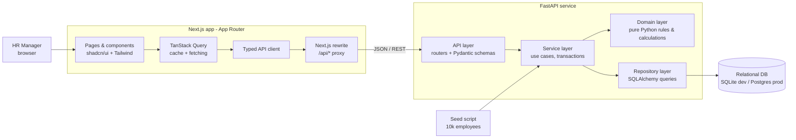
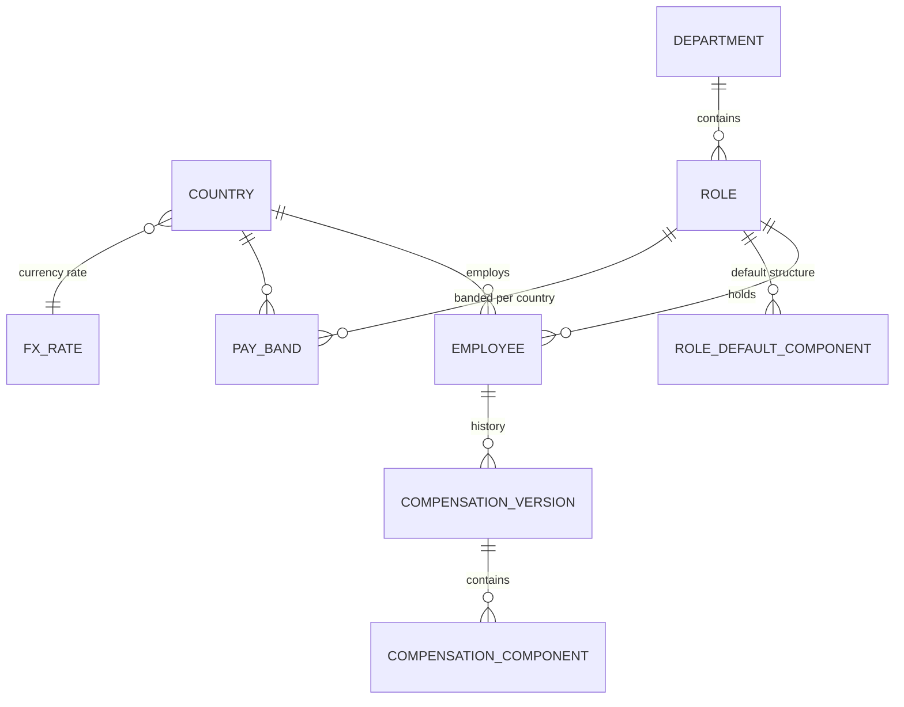

# Architecture & Design Notes

Companion to [REQUIREMENTS.md](REQUIREMENTS.md) and [COMPENSATION_MODEL.md](COMPENSATION_MODEL.md). This doc explains **how** the system is built and **why** each choice was made.

## 1. System overview



A single deployable backend and a single Next.js frontend. The browser only talks to the Next.js origin; Next.js forwards `/api/*` to FastAPI. This keeps everything same-origin, so there are no CORS headaches and cookies stay first-party. There are no microservices, queues, or caches: at 10k employees a well-indexed relational database answers everything in milliseconds, and extra infrastructure would only add failure modes.

## 2. Tech stack

| Area | Choice | Why |
|---|---|---|
| API | **FastAPI** (Python 3.12) | Typed, async-capable, auto OpenAPI docs, matches the role. |
| Validation / schemas | **Pydantic v2** | Request/response contracts; generates the OpenAPI spec the UI is typed from. |
| ORM | **SQLAlchemy 2.0** (typed) | Mature; works with both SQLite and Postgres. |
| Migrations | **Alembic** | Versioned schema, reproducible deploys. |
| Database | **SQLite** locally & in tests, **Postgres** in production | SQLite needs no setup and makes tests fast; Postgres for a real deployment. Only portable SQL is used (see §6). |
| Backend tests | **pytest**, httpx `TestClient`, coverage | Standard, fast, readable. |
| Lint / types | **ruff**, **mypy** | Keeps style consistent and catches errors before they reach review. |
| Frontend | **Next.js 15 (App Router) + React + TypeScript** | File-based routing, layouts, middleware for route protection, and built-in API proxying (rewrites). Deploys natively on Vercel. |
| Components | **shadcn/ui** (Radix primitives + Tailwind CSS) | Components are copied into the repo, so we own and can style them; accessible via Radix; a clean, modern look without fighting a heavy theme system. |
| Data table | **TanStack Table** (shadcn `DataTable` pattern) in server-side mode | Paging, sorting, and filtering are driven by API query params, never 10k rows in the browser. |
| Server state | **TanStack Query** | Caching, loading/error states, and invalidation after edits. No hand-rolled global store. |
| Forms | **React Hook Form + Zod** (shadcn `Form`) | Client-side validation that mirrors server rules, for fast feedback. |
| Charts | **Recharts** via **shadcn Charts** | shadcn's chart components are built on Recharts, so charts share the same theme tokens as the rest of the UI. |
| Frontend tests | **Vitest + React Testing Library** | Fast, behaviour-focused component tests. |
| Deploy | **Render** (API + managed Postgres), **Vercel** (Next.js) | Free tiers, Git-based deploys, no ops work. |

## 3. Backend layering

```
backend/app/
├── api/            # FastAPI routers. HTTP only: parse, call a service, map errors → status codes
├── schemas/        # Pydantic request/response models (the API contract)
├── services/       # Use cases: create employee, revise compensation, compute insights
├── domain/         # PURE Python: Money, components, package calculations, validation rules
├── repositories/   # SQLAlchemy queries; the only layer that knows SQL
├── models/         # SQLAlchemy ORM tables
├── core/           # config, DB session, clock, error types
└── seed/           # deterministic data generator
```

**Dependency rule:** `api → services → (domain, repositories)`. **`domain` imports nothing** from the framework, ORM, or database.

**Why:** all the interesting logic (total-comp calculation, FTE normalisation, compa-ratio, overlap rules, the 25 edge cases) lives in `domain/` as plain functions and dataclasses. It can be unit-tested in microseconds without a database, which makes TDD practical. Routers stay thin and boring.

**Injected clock:** "current package" depends on today's date (future-dated raises, E14). Services take a `Clock` dependency and endpoints accept an optional `as_of` date. Tests pin the date, so time-dependent behaviour is deterministic.

## 4. Data model



| Table | Key columns | Notes |
|---|---|---|
| `country` | `code` (ISO-3166), `name`, `currency` (ISO-4217) | One currency per country. |
| `fx_rate` | `currency`, `usd_per_unit` (decimal), `rate_set` | Fixed, versioned reference rates. |
| `department` | `id`, `name` | |
| `role` | `id`, `department_id`, `family`, `level` (1–5), `title` | e.g. Software Engineer, L3. |
| `role_default_component` | `role_id`, `type`, `basis`, `value`, `frequency` | Template copied onto new hires (E3, E4). |
| `pay_band` | `role_id`, `country_code`, `min/mid/max_minor` | Unique per (role, country). |
| `employee` | `id`, `employee_code` (unique), `name`, `email` (unique), `country_code`, `role_id`, `employment_type`, `fte`, `status`, `hire_date`, `termination_date` | |
| `compensation_version` | `id`, `employee_id`, `effective_from`, `effective_to` (nullable), `reason`, `currency`, `base_annual_minor`, **derived:** `fixed_cash_minor`, `target_variable_minor`, `ttc_minor`, `ttc_usd_minor`, `compa_ratio` | Immutable once written. |
| `compensation_component` | `version_id`, `type`, `basis`, `value`, `frequency`, `payout_date` | |

### Design decisions
- **Versions are immutable; a change appends a new row.** A revision closes the previous version (`effective_to = new.effective_from`) and inserts the new one in **one transaction**. The service checks for overlaps (E16) and a partial unique index backs it up ("one open version per employee").
- **Derived totals are stored on the version.** Because a version never changes and FX rates are versioned, its TTC, USD value, and compa-ratio can be computed **once at write time** by the domain layer. Insight queries then become simple `SUM`/`AVG`/`GROUP BY` over integer columns, with no recalculation of 10k packages per request. This is a deliberate denormalisation, and it's safe precisely because of immutability.
- **Money is stored as integers** (`*_minor` = cents/paise), with the currency on the row. A `Money` value object in the domain prevents adding different currencies.
- **"Current" version** = `effective_from <= as_of AND (effective_to IS NULL OR effective_to > as_of)`.

### Indexes
`employee(country_code)`, `employee(role_id)`, `employee(status)`, `employee(name)`, unique `employee(employee_code)`, unique `employee(email)`, `compensation_version(employee_id, effective_from)`, unique `pay_band(role_id, country_code)`.

## 5. API design

REST, JSON, `/api/v1` prefix; OpenAPI docs at `/docs`.

| Method & path | Purpose |
|---|---|
| `GET /employees` | Paginated list. `page`, `page_size` (≤ 100), `sort`, `q` (name/code search), filters: `country`, `department`, `role`, `level`, `employment_type`, `status`, `band_position`. Returns `{items, total, page, page_size}`. |
| `GET /employees/{id}` | Profile + current package + band comparison. |
| `POST /employees` | Hire: creates the employee + first version (role defaults applied, overridable). |
| `PATCH /employees/{id}` | Update non-compensation details. |
| `DELETE /employees/{id}` | Soft-terminate by default (sets status + termination date). |
| `GET /employees/{id}/compensation` | Full version history. |
| `POST /employees/{id}/compensation` | New version (raise, promotion, correction) with `effective_from` + `reason`. |
| `GET /employees/export.csv` | CSV of the current filtered list (S4). |
| `GET /insights/summary` | Headcount, total TTC (USD), fixed/variable mix, bonus-eligibility rate. |
| `GET /insights/breakdown` | `group_by=country|department|level`, optional filters → count, min/median/mean/max. |
| `GET /insights/band-distribution` | Below / in / above band counts by group. |
| `GET /insights/exceptions` | Out of band, missing package, pending future changes. |
| `GET /reference/{countries,departments,roles,pay-bands}` | Dropdown data. |
| `POST /auth/login` · `POST /auth/logout` · `GET /auth/me` | Session management (see §5a). Every other endpoint requires a session. |

**Errors** use one consistent shape, `{ "error": { "code": "OVERLAPPING_VERSION", "message": "...", "details": {...} } }`. Domain exceptions map to 400/404/409/422 in a single handler, so routers have no try/except clutter.

**Pagination:** offset/limit. At 10k rows offset cost is negligible, and keyset pagination would complicate arbitrary sorting for no benefit.

## 5a. Authentication (env-based single login)

```mermaid
sequenceDiagram
    participant B as Browser
    participant N as Next.js (middleware + /api proxy)
    participant A as FastAPI
    B->>N: GET /employees (no cookie)
    N-->>B: 307 redirect → /login
    B->>N: POST /api/auth/login {email, password}
    N->>A: forward
    A->>A: compare email; bcrypt.verify(password, HR_ADMIN_PASSWORD_HASH)
    A-->>B: 200 + Set-Cookie: session=<signed JWT>; HttpOnly; Secure; SameSite=Lax
    B->>N: GET /api/employees (cookie)
    N->>A: forward with cookie
    A->>A: verify JWT signature + expiry
    A-->>B: 200 data
```

| Aspect | Decision |
|---|---|
| Credentials | `HR_ADMIN_EMAIL` and `HR_ADMIN_PASSWORD_HASH` (bcrypt) as backend env vars. No users table. The plain password is never stored, and a helper script generates the hash. |
| Session | Signed JWT (`SESSION_SECRET`, HS256, 8-hour expiry) in an **HttpOnly, Secure, SameSite=Lax** cookie. JavaScript can't read it, which limits XSS impact. |
| Enforcement | **FastAPI is the real gate:** a single `require_session` dependency on every router except `/auth/login`. Next.js `middleware.ts` only checks that the cookie exists and redirects to `/login`, for UX. |
| Same-origin | Because Next.js proxies `/api/*`, the cookie is first-party, with no cross-site cookie or CORS configuration. |
| Failure handling | Generic "invalid email or password" message (no account enumeration); constant-time comparison. |
| Not included (yet) | Rate limiting / lockout, password reset, multiple users, roles. Noted as next steps. |

Tests cover the happy path, wrong password, missing or expired or tampered cookie → 401, and that every protected router has the dependency attached (a single test walks the route table).

## 6. Performance at 10k employees

| Concern | Approach |
|---|---|
| Listing 10k rows | Never sent to the browser. Server-side paging, sorting, and filtering; max page size 100. |
| Search | Indexed `LIKE 'prefix%'` on name and code. Postgres `pg_trgm` is a later option if fuzzy search is needed. |
| Insight aggregates | SQL `GROUP BY` over stored derived integer columns of current versions: one query per widget. |
| Median / percentiles | SQLite has no `percentile_cont`. To stay portable, the repository fetches the sorted `ttc_usd_minor` column for the filtered group (≤ 10k integers, ~80 KB) and the domain computes percentiles. This is fast, exact, and the same on both databases. |
| N+1 queries | Explicit `selectinload` for components; list endpoints use a single joined query. |
| Seeding | Bulk inserts in batches inside one transaction; target < 15 s for 10k employees + ~30k versions. |
| Frontend | TanStack Query caching, debounced search (300 ms), `placeholderData: keepPreviousData` to avoid table flicker while paging. |

**Budget:** p95 < 300 ms for list and insight endpoints on seeded data. Verified with a small timing script during development; numbers recorded in `docs/PERFORMANCE.md`.

## 7. Frontend structure

```
frontend/
├── app/                      # Next.js App Router
│   ├── layout.tsx            # root layout, providers (TanStack Query, theme)
│   ├── login/                # public login page
│   ├── (app)/                # authenticated shell: sidebar + header
│   │   ├── page.tsx          # Overview (insights + exceptions summary)
│   │   ├── employees/        # directory, [id] profile, new (hire)
│   │   ├── insights/
│   │   └── exceptions/
├── components/
│   ├── ui/                   # shadcn/ui components (owned, generated into repo)
│   └── ...                   # shared: Money, BandIndicator, EmptyState, ErrorState
├── features/                 # feature modules: employees, insights, exceptions
├── lib/                      # api client + query hooks, formatting, Zod schemas
├── middleware.ts             # redirect to /login when no session cookie
└── next.config.ts            # rewrites /api/* → FastAPI
```

**Client vs. server components:** pages are thin server components that render the shell; interactive parts (data table, forms, charts) are client components that fetch through TanStack Query. FastAPI stays the single source of business logic, and Next.js doesn't duplicate it.

Pages: **Overview** · **Directory** → **Employee profile** (package, band gauge, history timeline, "Revise compensation" dialog) · **Insights** · **Exceptions**. URL search params hold the filters, so views can be bookmarked and shared.

## 8. Testing strategy

| Level | What | How | Share |
|---|---|---|---|
| **Domain unit** | Calculations, Money, validation, overlap rules, every edge case E1–E25 | Pure pytest, no DB, table-driven (`parametrize`) | Most tests |
| **Service / repository** | Transactions, filters, aggregates, current-version selection | pytest + in-memory SQLite, fixture factories, pinned clock | Some |
| **API** | Status codes, contracts, error shape | `TestClient` against in-memory DB | Some |
| **Frontend** | Form validation, table/filter wiring, money formatting | Vitest + RTL with mocked API hooks | Few, focused |

Principles: **fast** (whole backend suite in seconds), **deterministic** (fixed clock, fixed FX, seeded random), **readable** (Arrange-Act-Assert, names describe behaviour, e.g. `test_part_time_employee_is_compared_to_band_at_fte`). Domain logic is developed **test-first**, and commits show test → implementation pairs.

## 9. Deployment

```
GitHub main ──▶ Render: API (Docker) ──▶ Render Postgres
           └──▶ Vercel: Next.js (rewrites /api/* → Render API via API_ORIGIN)
```
- Alembic migrations run on API start-up; the seed runs once via a one-off command.
- The browser never calls the API origin directly (same-origin via rewrites), so CORS stays closed.
- Config through environment variables (`DATABASE_URL`, `API_ORIGIN`, `HR_ADMIN_EMAIL`, `HR_ADMIN_PASSWORD_HASH`, `SESSION_SECRET`); `.env.example` committed with placeholders only, and real values live in the hosting provider's secret store.

## 10. Key trade-offs

| Decision | Alternative | Why we chose it |
|---|---|---|
| Next.js + separate FastAPI | Next.js API routes only, or a Vite SPA | Python owns the domain (role requirement, best tested there). Next.js adds routing, middleware, and same-origin proxying that a plain SPA would have to hand-roll. |
| shadcn/ui | MUI / Ant Design | Owned, Tailwind-styled components give a modern, minimal look; we trade MUI's ready-made DataGrid for TanStack Table, which is a small, well-understood amount of code. |
| Modular monolith | Microservices | One team, one domain, 10k rows. Simplicity wins. |
| Store derived totals on immutable versions | Compute on every read | Fast, simple aggregate queries. Safe because versions never change. |
| SQLite (dev/test) + Postgres (prod) | Postgres everywhere | Zero-setup dev and fast tests. Risk of dialect drift is handled by using only portable SQL. |
| Fixed reference FX | Live FX API | Deterministic and testable; standard practice for comparing pay. |
| Offset pagination | Keyset | Negligible cost at this scale, and arbitrary sort columns stay simple. |
| Soft-terminate instead of hard delete | Hard delete | Salary history is a record HR needs to keep. |
| Single env-configured login | No auth / full user management / OAuth provider | Salary data shouldn't sit behind a public URL, but one persona doesn't justify a users table or an identity provider. One auth dependency makes swapping in SSO later a local change. |
