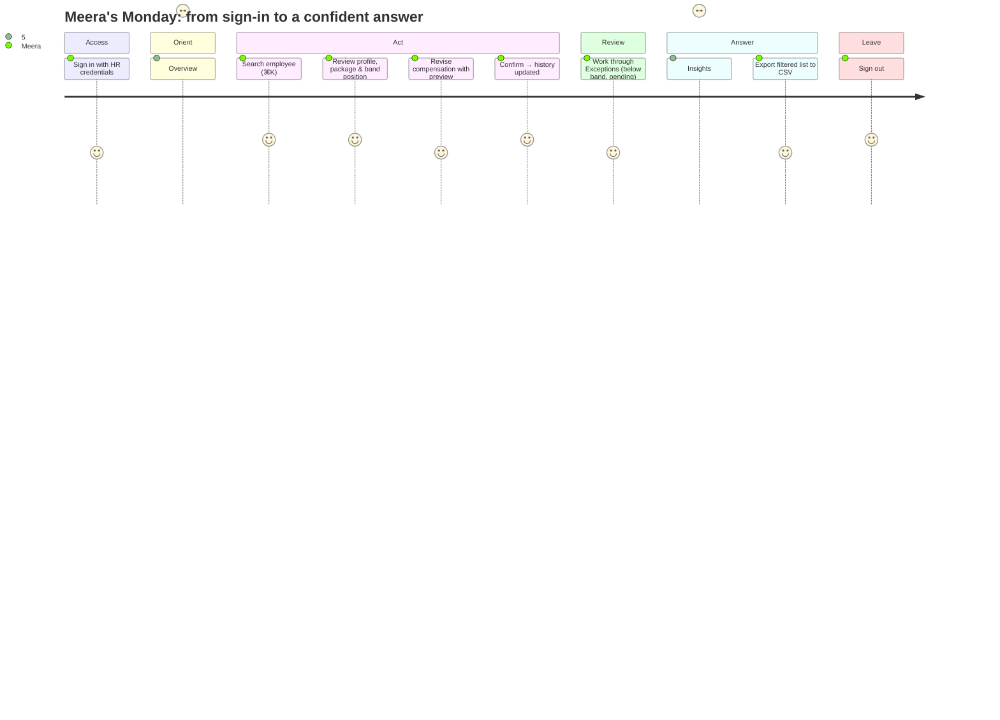

# Product Design: Persona, Brand Archetype & User Journey

Companion to [REQUIREMENTS.md](REQUIREMENTS.md). This doc defines **who we design for**, **how the product should feel**, and **how the HR Manager moves through it**. The visual UI design is built from it.

## 1. User persona

> **Meera Iyer, HR Manager (Compensation & People Ops), ACME Org**
> *"I don't need more data. I need to trust the number and know what to do about it."*

| | |
|---|---|
| **Role** | Owns salary data for ~10,000 employees across 8 countries. Reports to the CHRO. Works with Finance (budget) and department heads (raises, promotions). |
| **Experience** | 8+ years in HR. Expert in Excel (VLOOKUPs, pivots), not technical. Comfortable with modern SaaS tools. |
| **A typical week** | Processes promotions and corrections, answers leadership questions ("What does Engineering in India cost us?"), prepares for the annual merit cycle, checks that new offers fit pay bands. |
| **Devices** | Laptop (13–15"), often with a second monitor. Desktop-first; tablet for review only. |

### Goals
1. Record pay changes **correctly the first time**, with a clear reason and date.
2. Answer leadership's pay questions **in minutes, with confidence**.
3. **Spot problems early**: people under-paid for their band, missing records, changes about to take effect.

### Frustrations today (Excel)
- Version chaos ("salary_final_v7_REAL.xlsx"); history is overwritten.
- A single typo changes someone's pay, and nothing catches it.
- Comparing countries means manual currency conversion.
- Bonus, commission, and allowances live in different sheets, so nobody sees an employee's full pay.
- Every leadership question becomes a half-day pivot-table exercise.

### What success feels like
*"I opened it, found the answer, and I'd defend that number in a leadership meeting."*

## 2. Brand archetype

### Primary: **The Sage**, clarity and trusted insight
The product's job is to **turn 10,000 rows into understanding**. The Sage values truth, knowledge, and clarity over noise. That is exactly what Meera needs when a CFO asks a pointed question.

**Supporting: The Caregiver.** Behind every row is a person's livelihood. The product should feel **careful and respectful**: no alarming red everywhere, calm confirmations before changes that affect someone's pay, plain language.

| Archetype trait | How it shows up in the product |
|---|---|
| Sage: clarity | Numbers first, with context always (every salary shown against its band, every figure with its currency). |
| Sage: truth | Transparent calculations ("How is this calculated?" on totals); history is never hidden. |
| Sage: calm expertise | Restrained palette, generous whitespace, no decorative chrome. |
| Caregiver: care | Confirmation summaries before pay changes ("Base 82,000 → 90,000 EUR, +9.8%, effective 1 Jan"). |
| Caregiver: reassurance | Helpful empty states and errors that say what to do next. |

**Archetypes we rejected:** *Ruler* (authoritative, corporate, cold; HR tools already feel like this), *Hero* (urgent, gamified; wrong for sensitive pay decisions), *Jester* (playful; erodes trust with salary data).

### Voice & tone
- **Precise:** "3 employees are below band in Engineering · India", not "Some issues found!"
- **Calm:** state facts, then offer an action. No exclamation marks.
- **Plain:** "Total pay", with "TTC" only in tooltips. "Below band", not "compa-ratio < 0.8".

## 3. Visual language

**Feel:** modern, minimal, editorial, like a well-designed financial report that you can click.

### Colour tokens

| Token | Value | Use |
|---|---|---|
| `background` | `#F8F7F4` warm paper | App background |
| `surface` | `#FFFFFF` | Cards, tables |
| `ink` | `#16181D` | Primary text |
| `muted` | `#5C6370` | Secondary text, labels |
| `border` | `#E5E3DD` | Hairlines |
| `primary` · *Insight Indigo* | `#3B46A0` | Primary actions, focus, selected nav |
| `primary-soft` | `#8E98F0` | Secondary data series (e.g. variable pay in mix bars) |
| `sage` · *in band / positive* | `#4F7D63` | In-band, success |
| `amber` · *attention* | `#B07A1E` (text on tint: `#7A4E06`) | Below band. The darker text shade keeps small labels above 4.5:1 contrast. |
| `rose` · *error / destructive* | `#B2433A` | Validation errors, terminate |
| `slate-violet` · *above band* | `#6B5FA8` | Above band (informational, not "bad") |

The product ships a **single light theme**. Dark mode is deliberately left out: it doubles the colour and contrast work for every status state, and the HR Manager works on an office laptop during the day. Rules: one primary colour per screen; status colours appear only on status. Below band is **amber, not red**, because it's something to review, not an error.

### Typography & layout
- **Geist Sans** for UI and **Geist Mono** with tabular figures for every amount, so columns of money line up.
- Type scale: 12 / 14 (body) / 16 / 20 / 28 / 36 (KPI numbers).
- Layout: left sidebar (Overview, Employees, Insights, Exceptions), a top bar with global search (⌘K), and an 8 px spacing grid. Rounded corners at 10 px, hairline borders, almost no shadows.
- Components: shadcn/ui, restyled with the tokens above.

## 4. Design principles
1. **Context over raw numbers.** A salary is always shown with its band position and currency.
2. **Preview before commit.** Every pay change shows the before → after, the % change, and the new band position before saving.
3. **Calm signalling.** Status is shown by colour + icon + text, never colour alone (accessibility).
4. **Progressive disclosure.** Summary first, details on demand (expand a component, open the history).
5. **Keyboard-friendly.** ⌘K to find any employee; forms are fully keyboard-operable.

## 5. User journey

| # | Stage | Screen | What Meera does | What the product does |
|---|---|---|---|---|
| 1 | **Sign in** | Login | Enters HR email and password. | Validates; generic error on failure; lands on Overview. |
| 2 | **Orient** | Overview | Sees the state of pay at a glance. | KPI cards (headcount, total annual pay in USD, median pay, % bonus-eligible) and an exceptions summary with deep links. |
| 3 | **Find** | Employees directory | Searches "Ravi", filters Country = India, Dept = Engineering. | Server-side table with band-position chips; filters kept in the URL. |
| 4 | **Understand** | Employee profile | Reviews Ravi's full package. | Header (role, level, country, type), package breakdown (base, allowances, bonus, total), band gauge with compa-ratio, history timeline. |
| 5 | **Act** | Revise compensation (full page) | Promotion: L3 → L4, base +12%, effective 1 Jan. | Applies the L4 role defaults (15% bonus), shows a **live preview**: before → after, % change, new band position. Validation inline. |
| 6 | **Confirm** | Inline confirm step (same page) | Checks the summary and confirms. | Saves a new version; toast "Compensation updated · effective 1 Jan 2027"; the change appears as *pending* until that date. |
| 7 | **Review** | Exceptions | Works through below-band employees. | Grouped list (below band, missing package, pending changes) with one-click into each profile. |
| 8 | **Answer** | Insights | Answers "How do we pay Engineering across countries?" | Breakdown by country/department/level (count, min / median / max), fixed vs. variable mix, band distribution. |
| 9 | **Share** | Directory → Export | Exports the filtered list. | CSV matching the current filters. |
| 10 | **Leave** | Any → Sign out | Signs out. | Session cleared; back to login. |

### Key scenarios to design and test
- **S-A Promotion with raise.** Role change, new defaults, future effective date (E14, E17).
- **S-B "Is anyone under-paid?"** Exceptions → profile → market adjustment (S1, S3).
- **S-C New hire.** Pick role → defaults pre-filled → override bonus → check offer against band (E3, M5).
- **S-D Leadership question.** Insights filtered to one department, then export.

## 6. UI design

The visual design (login → overview → directory → profile → revise compensation → exceptions → insights) is built in Claude Design from this document. Link: see [UI_DESIGN.md](UI_DESIGN.md).
